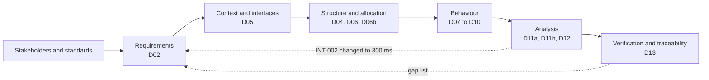
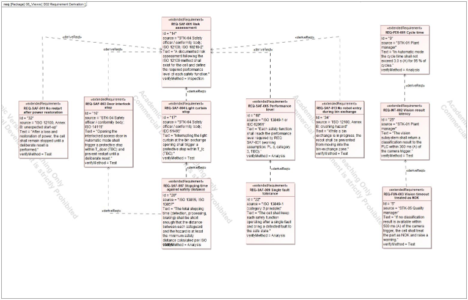
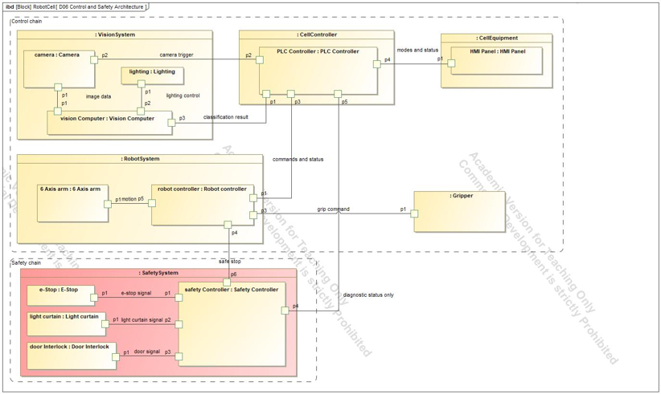
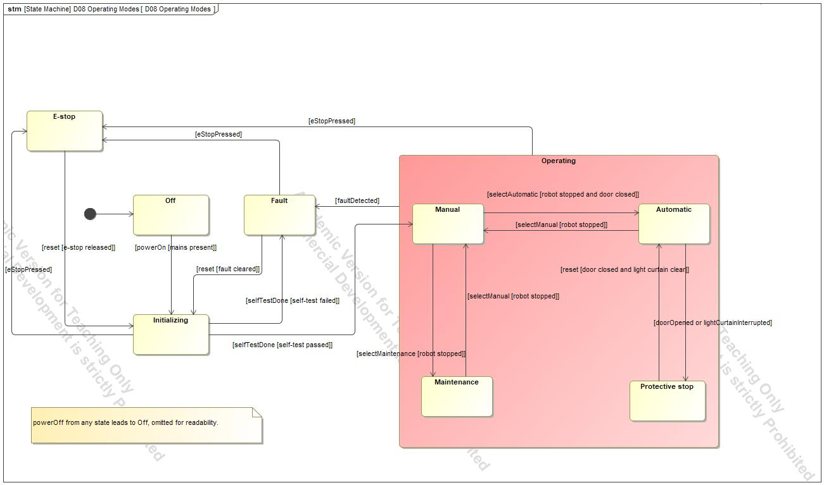

# Model-Based Systems Engineering of a Vision-Guided Pick-and-Place Robot Cell

   **[Read the full report (PDF)](report/MBSE-Full-Report.pdf)**

A complete SysML model of a fenced robot cell that picks parts from a conveyor, classifies them with a camera and sorts them into an OK bin or a reject bin. The model runs from stakeholder needs to verified requirements, and four parametric analyses check the key numbers.

**Tool:** Cameo Systems Modeler (academic licence) · **Language:** SysML 1.x · **Author:** Maher Alaa Aldeen, M.Sc. Mechatronics, University of Duisburg-Essen

## At a glance

| | |
|---|---|
| Requirements | 32 in 7 categories (FUN, PER, SAF, INT, ENV, CYB, MNT), each with a source and a verification method |
| Structure | 6 subsystems, 9 typed interfaces at the boundary, separate control and safety chains |
| Behaviour | 1 activity, 1 state machine with 4 operating modes, 2 sequence diagrams |
| Analysis | 4 parametric analyses run as simulations |
| Verification | 20 test cases; 32 of 32 requirements have a verify relation |
| Allocation | 30 of 32 requirements have a satisfy relation; the other 2 are explained |

## Results

| Requirement | Check | Result | Limit | Margin | Status |
|---|---|---|---|---|---|
| REQ-PER-001 | Cycle time | 2.65 s | 3.0 s | +0.35 s | Pass |
| REQ-INT-002 | Vision latency | 0.25 s | 0.30 s | +0.05 s | Pass after the limit changed from 200 ms |
| REQ-SAF-007 | Safety distance, light curtain | 608 mm needed | 800 mm installed | +192 mm | Pass, constants TBC |
| REQ-PER-005 | Payload ratio | 0.26 | 0.50 | +0.24 | Pass, simplified check |

## How the work fits together



Each step produces the input of the next one, and two later steps changed earlier ones. The write-up for each step is in `docs/`.

## Key diagrams

**D02 Requirement derivation.** Where each requirement comes from and how requirements derive from each other.


**D06 Control and Safety Architecture.** The safety chain runs from sensor to safe stop and touches the control chain only at the safe stop and the diagnostic status.


**D08 Operating Modes.** Four modes; Maintenance cannot go directly to Automatic, and every mode change requires the robot to be stopped.


## Contents

| Page | What it shows |
|---|---|
| [01 Scope and stakeholders](docs/01-scope-and-stakeholders.md) | Boundary, stakeholders, what is out of scope |
| [02 Requirements and hazards](docs/02-requirements-and-hazards.md) | How requirements were written, sourced and derived |
| [03 Structure and interfaces](docs/03-structure-and-interfaces.md) | Decomposition, context, interface blocks, safety allocation |
| [04 Behaviour](docs/04-behaviour.md) | Cycle, modes, door-open stop, vision timeout |
| [05 Analysis](docs/05-analysis.md) | The four calculations with hand checks |
| [06 Verification and traceability](docs/06-verification-and-traceability.md) | Test cases, matrices, coverage and gaps |
| [07 Decisions, assumptions and limits](docs/07-decisions-assumptions-limits.md) | Why choices were made, every assumed value, what is not done |
| [08 Standards register](docs/08-standards-register.md) | Every standard referenced and why |

## Repository layout

```
diagrams/   PNG export of every diagram
evidence/   simulation logs and matrix screenshots
data/       requirements and matrices as CSV
model/      Cameo project file (.mdzip)
docs/       the step-by-step write-up
```

## Opening the model

Open `model/` file in Cameo Systems Modeler (an academic or trial licence works). Start with the package `08_Views`, which holds the requirement derivation diagram and both D13 matrices; the other packages are numbered in the order of the work (`00_Admin` to `07_Verification`).

## Limitations

The constants in the safety-distance formula (ISO 13855) are TBC, only the light curtain is analysed, standard editions are unchecked, the payload check is a simplified ratio, and timing and mass values are assumptions, not measurements. The full list is in [page 07](docs/07-decisions-assumptions-limits.md).

## Licence

Documents: CC BY 4.0. The standards are cited by number only; no standard text is reproduced.
