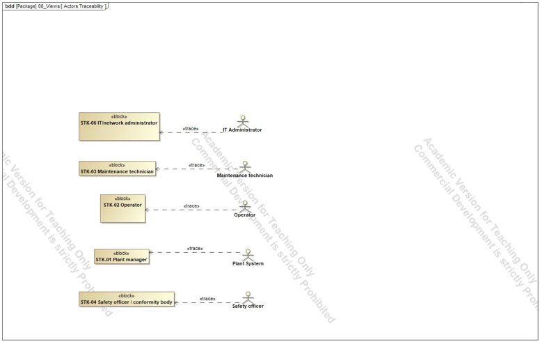
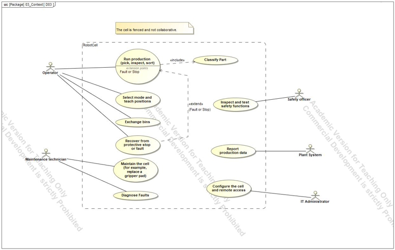

# 01 Scope and stakeholders

## Question

Who is the cell for, what is it supposed to do, and where does the system end?

## Why this comes first

Every later diagram depends on the boundary. If the boundary is unclear, interfaces and requirements drift. So the first step fixes the system of interest and the people who care about it.

## System of interest

A **fenced** robot cell that takes parts from a conveyor, checks each one with a camera, and places it in an OK bin or a reject bin. Fenced means the robot never works in the same space as a person without a stop; the cell is not collaborative. This choice is deliberate: it keeps the safety case within ISO 10218 and the machinery rules for a guarded cell and avoids the extra power-and-force limits of collaborative operation.

## Stakeholders

| ID | Stakeholder | Interest |
|---|---|---|
| STK-01 | Plant manager | Throughput, cycle time, availability |
| STK-02 | Operator | Simple start, stop and bin exchange; clear status |
| STK-06 | IT / network administrator | Secure configuration access and production data |

The remaining stakeholders are shown in diagram D01.

## Diagrams

- **D01** answers who has needs and why each matters.
- **D03** answers who uses the cell and for what goal, and what is out of scope. Actors found here later become interfaces in D05.

## What it hands to the next step

The stakeholders become the sources of requirements (page 02), and the actors become boundary interfaces (page 03).
