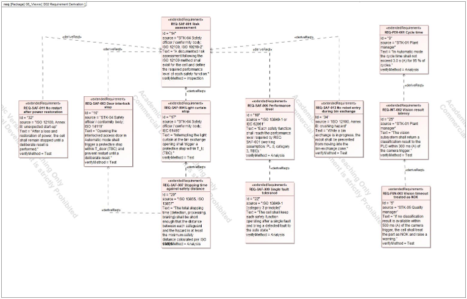

# 02 Requirements and hazards

## Question

What must the cell do, how well, and how safely, and where does each requirement come from?

## What was built

32 requirements in seven categories:

| Category | Meaning |
|---|---|
| FUN | Function |
| PER | Performance |
| SAF | Safety |
| INT | Interface |
| ENV | Environment |
| CYB | Cybersecurity |
| MNT | Maintenance |

Each requirement is an ExtendedRequirement with three fields:

- **Source**: a stakeholder or a standard. Without a source, nobody can say why the requirement exists.
- **VerifyMethod**: test, analysis, inspection or demonstration. Without it, nobody can say how it would be checked.
- **Risk**: how much it matters if the requirement fails.

Writing source and verification method into the requirement itself keeps them next to the text. The verify relation added later in the model (page 06) then proves the planned method.

## Writing rules

- **One "shall" per requirement.** A requirement with two "shall" statements has two pass or fail results. Eight requirements were reworded to follow this rule.
- **Numbers carry a mark.** A value from a standard or stakeholder is plain; an assumed value is marked (A) or TBC, and is listed in the assumptions register (page 07).
- **One requirement, one subject.** "The cell shall ..." or "The safety controller shall ...", never both.

## Hazard-based requirements

Three requirements were written from hazard thinking in the style of ISO 12100 rather than copied from a list:

| ID | Requirement | Hazard behind it |
|---|---|---|
| REQ-SAF-011 | No restart after power restoration | Unexpected motion after a power cut |
| REQ-SAF-012 | Energy isolation for maintenance | Stored or live energy while a person works in the cell |
| REQ-SAF-013 | No robot entry during bin exchange | A person reaches into the cell while the robot moves |

## Derivation

D02 holds 10 derive relations, for example REQ-SAF-003, 004, 005, 011 and 013 derive from the top-level REQ-SAF-001, and REQ-INT-002 derives from REQ-PER-001 (the vision latency must fit inside the cycle time). 21 trace relations link requirements to the stakeholders in the Day 1 model.

## What it changed later

The cycle-time analysis (page 05) showed that REQ-INT-002 was stricter than the cycle-time budget needs. The limit was changed from 200 ms to 300 ms and recorded as an assumption.

## What it hands to the next step

The requirements define what the context diagram (page 03) has to expose and what the analyses (page 05) have to check.
