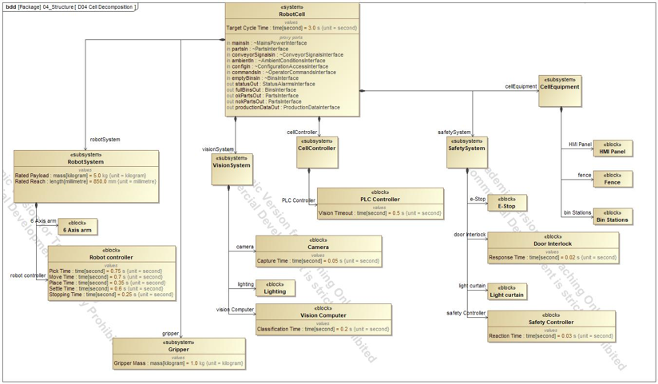
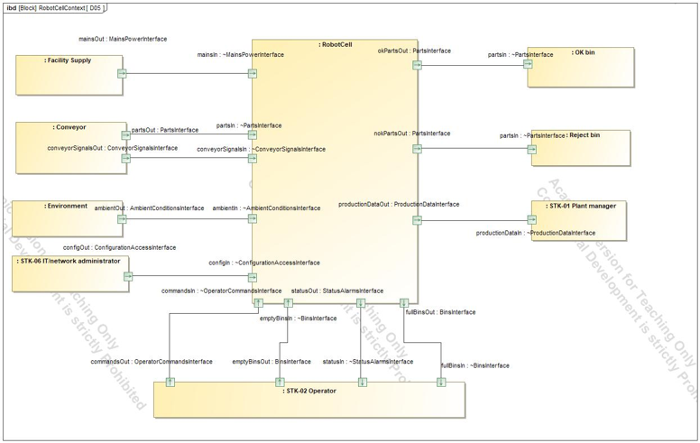
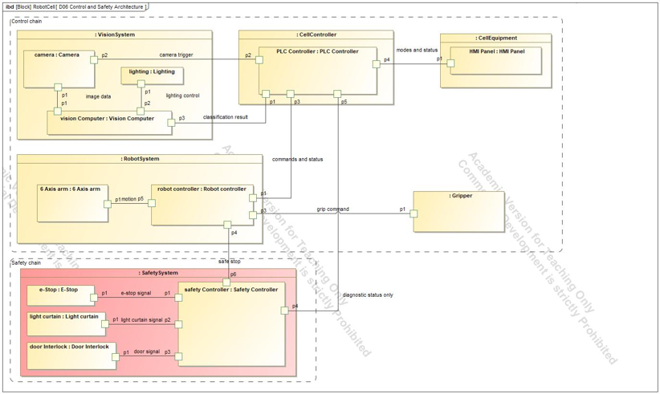
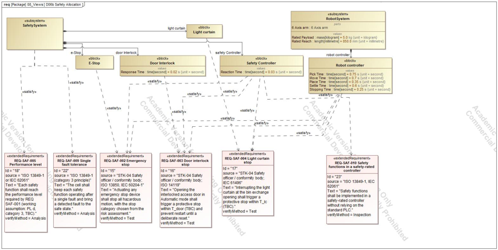

# 03 Structure and interfaces

## Questions

What are the parts of the cell, what crosses its boundary, how are the parts connected, and which part implements each safety requirement?

## D04 Cell Decomposition

The cell is a block with six subsystems: RobotSystem, VisionSystem, CellController, SafetySystem, CellEquipment, and the Gripper inside the robot system. Key values are typed as value properties so analyses can read them later: Target Cycle Time 3.0 s, Rated Payload 5.0 kg, Rated Reach 850 mm, Gripper Mass 1.0 kg.

## D05 Context

The cell is shown with everything outside it: facility supply, conveyor, environment, OK bin, reject bin, and the stakeholders. Twelve connectors cross the boundary and each uses a typed port.

Nine interface blocks define what crosses: mains power, parts, bins, conveyor signals, ambient conditions, configuration access, operator commands, status and alarms, and production data. Each has typed flow properties, for example a block `Part` or signals `PartPresent`, `ConveyorStop`, `StartCommand`.

**Lesson.** A port pair must be opposite: the sending port is plain and the receiving port is conjugated. The first version had red connectors because the receiving ports were not conjugated.

## D06 Control and Safety Architecture

Eight control connectors and five safety connectors show two chains. The safety chain (E-Stop, door interlock, light curtain, safety controller) runs from sensor to safe stop and touches the control chain (PLC, robot controller) only at the safe stop and the diagnostic status. This is the visible form of REQ-SAF-010, the independence requirement, and the architectural concept in ISO 13849-1.

## D06b Safety Allocation

Twelve satisfy relations connect safety requirements to the blocks that implement them. A requirement with no satisfying block is not implemented, and a block with no requirement has no purpose.

## What it hands to the next step

The structure gives the behaviour models (page 04) their partitions and the analyses (page 05) their value properties.
