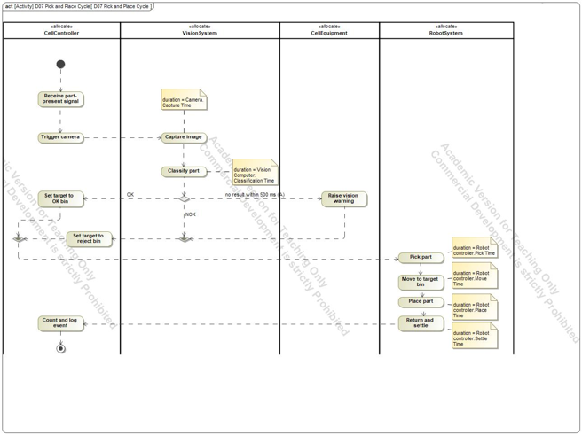
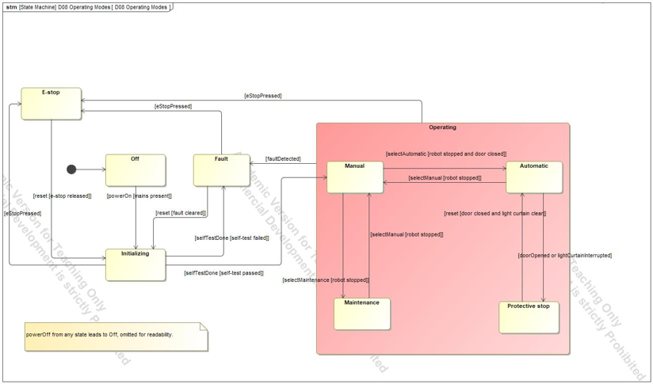
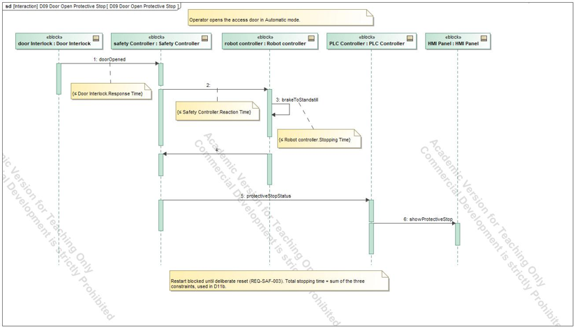
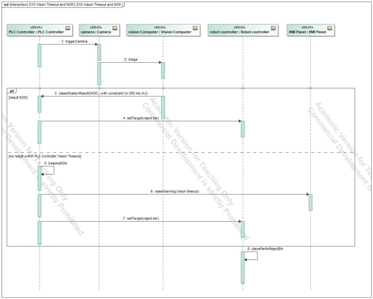

# 04 Behaviour

## Questions

What steps make up one cycle, which modes exist, and what happens in time when something goes wrong?

## D07 Pick and Place Cycle

An activity diagram with four partitions (CellController, VisionSystem, CellEquipment, RobotSystem). Six steps carry a duration note that points to a value property: capture, classification, pick, move, place and settle. These durations feed the cycle-time analysis (page 05).

## D08 Operating Modes

A state machine with the states Off, Initializing, E-stop, Fault and a composite Operating state that holds Manual, Automatic, Maintenance and Protective stop. Fifteen transitions carry guards. The four modes are Automatic, Manual, Maintenance and Fault; Off, Initializing, E-stop and Protective stop are system states.

Checks made on this diagram: every state has an exit, Maintenance cannot go directly to Automatic, and every mode change requires the robot to be stopped. REQ-FUN-004 states that the cell is in at most one mode at a time.

## D09 Door Open Protective Stop

A sequence diagram: the door opens in Automatic mode, the interlock detects it, the safety controller commands a stop and the robot reaches standstill. Three time constraints on the messages match the values used in the safety-distance analysis, so the sequence and the calculation cannot drift apart.

## D10 Vision Timeout and NOK

The non-nominal path: if the vision result is late (timeout 0.5 s) the controller raises an HMI warning, and a NOK part goes to the reject bin. An alternative fragment separates the branches. A first draft had one message inside the fragment that belonged after it; it was moved below the fragment.

## What it hands to the next step

The timings in D07 and D09 are the inputs of the four analyses.
