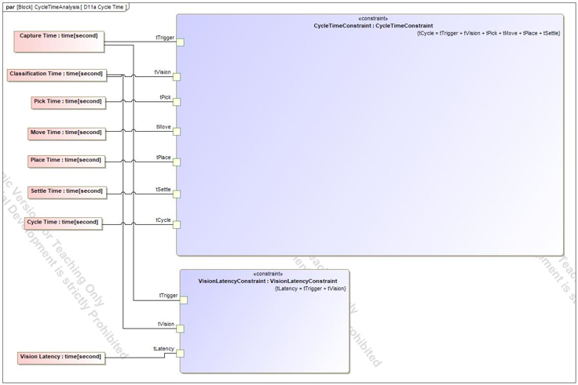
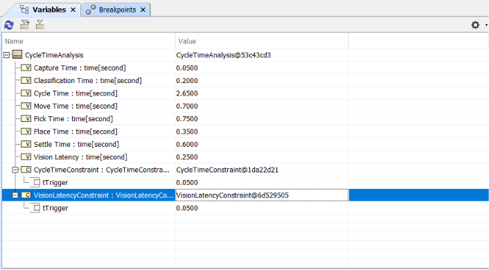
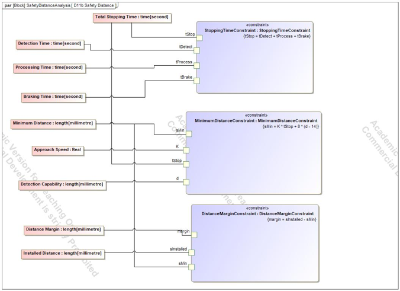
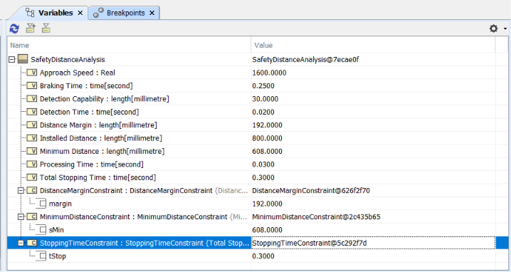
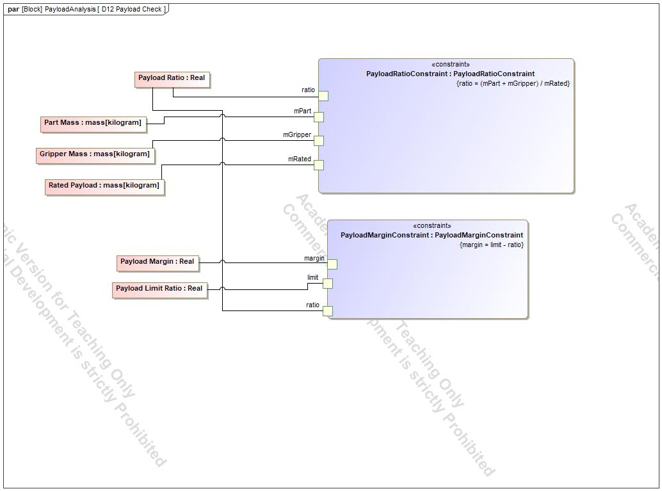
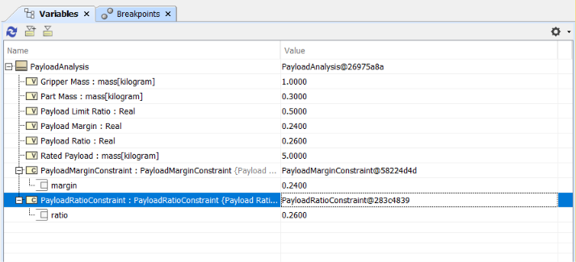

# 05 Analysis

Four parametric analyses were run in Cameo with Simulation → Run. Each result was also checked by hand.

## Cycle time (D11a)

Cycle time is the sum of the six timed steps:

| Step | Time |
|---|---|
| Capture | 0.05 s |
| Classification | 0.20 s |
| Pick | 0.75 s |
| Move | 0.70 s |
| Place | 0.35 s |
| Settle | 0.60 s |
| **Total** | **2.65 s** |

Limit 3.0 s (REQ-PER-001), margin +0.35 s. Vision latency is capture plus classification: **0.25 s**.

## The finding: REQ-INT-002

The vision latency limit was 200 ms with no basis. The analysis showed the budget absorbs 250 ms (2.65 s of 3.0 s), so the limit was changed to **300 ms (A)**, which gives a margin of +0.05 s. The decision is recorded on page 07.

## Safety distance (D11b)

The formula from ISO 13855 for a light curtain is S = K x T + 8 x (d - 14):

| Quantity | Value | Status |
|---|---|---|
| Door interlock response | 0.02 s | Assumed |
| Safety controller reaction | 0.03 s | Assumed |
| Robot stopping time | 0.25 s | Assumed |
| Total stopping time T | 0.30 s | Sum |
| Approach speed K | 1600 mm/s | TBC |
| Detection capability d | 30 mm | Assumed |
| **Minimum distance S** | 1600 x 0.30 + 8 x 16 = **608 mm** | |
| Installed distance | 800 mm | Assumed |
| **Margin** | **+192 mm** | |

The result depends on the TBC constants, and only the light curtain is analysed, not the door interlock.

## Payload (D12)

Ratio = (part mass + gripper mass) / rated payload. With the model's values this is 1.3 kg of 5.0 kg = **0.26**, against a limit of 0.50 (REQ-PER-005), margin +0.24. This is a simplified ratio, not a joint-torque analysis.

## Why these four

Each one turns a requirement that has a number into a calculation, so an assumed or unrealistic value shows up early. They were chosen because the model already held the inputs.
