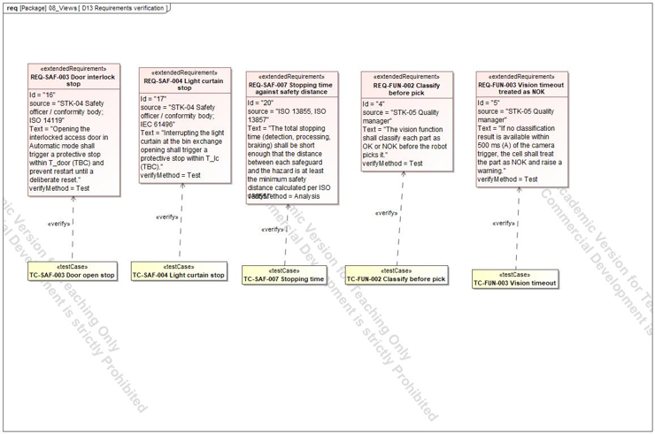
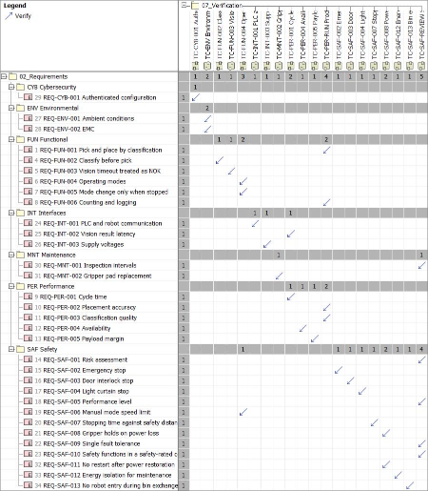
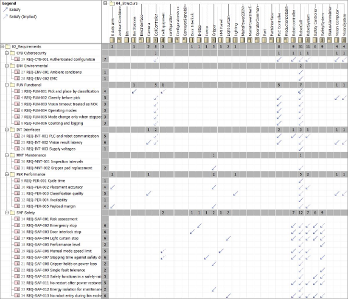

# 06 Verification and traceability

## Questions

Is every requirement verified, and is every requirement implemented by something?

## Test cases

20 test cases in the package `07_Verification`, each linked to its requirement by a verify relation:

- The first five cover the safety and functional requirements: TC-SAF-003, TC-SAF-004, TC-SAF-007, TC-FUN-002, TC-FUN-003.
- Fifteen more cover the rest, for example TC-PER-RUN, TC-SAF-002, TC-SAF-012, TC-SAF-013, TC-INT-001, TC-ENV and TC-CYB-001.

## Verify matrix

**32 of 32** requirements have exactly one verify relation.

## Satisfy matrix

**30 of 32** requirements have a satisfy relation, counting the implied satisfy through the block hierarchy.

## Gap list

| # | Gap | Reason |
|---|---|---|
| 1 | REQ-SAF-001 and REQ-MNT-001 have no satisfy relation | Satisfied by project documents (risk assessment, maintenance manual), not by a block |
| 2 | Seven requirements have no source relation to a stakeholder: FUN-005, SAF-006, SAF-010, INT-001, INT-003, ENV-002, SAF-012 | Their source is a standard, recorded in the Source property |
| 3 | RobotSystem, VisionSystem, CellController and CellEquipment satisfy nothing directly | They are grouping blocks; their parts do |
| 4 | Source properties hold no clause numbers | The standards have not been read yet |
| 5 | The door interlock distance is not analysed in D11b | Only the light curtain was in scope |
| 6 | ISO 13855 constants K and C are TBC | Standard not read yet |

A gap list is a result, not a failure: it says exactly what the model does not yet prove.
